<div align="center">

[Русский](README.ru.md) · **English**

<br>



<a href="https://github.com/sailxx/Okto-vscode-theme/releases/latest"></a>&nbsp;&nbsp;<a href="CHANGELOG.md"></a>

**Okto for VS Code is two color themes, file icons and color-coded folders.** The ink-violet **Okto Dark** and the warm lilac **Okto Light** with a pink accent, flat colorful icons for 37 file types and 10 kinds of folders, and detailed code highlighting. Not a single line of code in the extension — just color.

</div>

<br>



<details>
<summary><b>Feature details</b></summary>

### Themes

**Okto Dark** has a deep ink-violet background, light text and a pink accent `#FF7DB0` (cursor, active tab, current line number, badges). **Okto Light** is a warm lilac background with a `#D62F78` accent and a violet status bar. Both themes style the whole VS Code interface: panels, tabs, lists, terminal, diff, Git, debugger, rainbow brackets and symbol icons.

### Code highlighting

Semantic highlighting (`semanticHighlighting`) is on, backed by 30+ TextMate rules: keywords, strings, numbers, functions, types, parameters (italic), `this`/`self`, properties, decorators, HTML tags and attributes, CSS selectors and properties, JSON keys, Markdown headings and links, diff.

### File icons

37 flat tiles with a white glyph: Python, JavaScript, TypeScript, JSON, YAML, Markdown, HTML, CSS, SQL, Docker, Git, Rust, Go, Java, C, C++, C#, Ruby, PHP, Swift, Kotlin, Svelte, Vue and more. There are dedicated icons for lock files, `.env`, tests (`*.test.ts`, `*.spec.js`), licenses, archives, PDF and plain text.

### Color folders

`src`, `docs`, `test`, `assets`, `public`, `config` / `.vscode`, `.git` / `.github`, `node_modules`, `scripts` — each has its own color and a badge on the front, closed and open. All other folders are violet.

</details>

<br>



<br>



<details open>
<summary><b>Installation</b></summary>

**One step** (clone the repository or download it as a ZIP):

```powershell
.\install.ps1      # Windows (PowerShell)
```

```bash
./install.sh       # macOS and Linux
```

The script copies the extension into the VS Code extensions folder (older Okto versions are removed). Restart VS Code and add this to `settings.json` (`Ctrl + Shift + P` → **Preferences: Open User Settings (JSON)**):

```json
"workbench.colorTheme": "Okto Dark",
"workbench.iconTheme": "okto-icons",
"workbench.productIconTheme": "okto-product-icons"
```

Use `"Okto Light"` for the light theme. You can also pick all three from the Command Palette: **Preferences: Color Theme**, **File Icon Theme** and **Product Icon Theme**.

**From a `.vsix`:** download `okto-theme-*.vsix` from the [release page](https://github.com/sailxx/Okto-vscode-theme/releases/latest) and run `code --install-extension okto-theme-2.0.0.vsix` (or **Extensions → ⋯ → Install from VSIX…**), then select the themes as described above.

The product icon theme replaces the built-in VS Code icons. Icons added by individual extensions are controlled by those extensions and may not be replaced by the theme.

</details>
