<div align="center">

**Русский** · [English](README.en.md)

<br>


<a href="https://github.com/sailxx/okto-vscode-theme/releases/latest"></a>&nbsp;&nbsp;<a href="CHANGELOG.md"></a>

**Okto для VS Code — две цветовые темы, иконки файлов и цветные папки.** Фиолетово-чернильная **Okto Dark** и тёплая лиловая **Okto Light** с розовым акцентом, плоские цветные иконки для 37 типов файлов и 10 видов папок, подробная подсветка кода. Ни одной строки кода в расширении — только цвет.

</div>

<br>


<details>
<summary><b>Подробнее о возможностях</b></summary>

### Темы

**Okto Dark** — глубокий фиолетово-чернильный фон, светлый текст, розовый акцент `#FF7DB0` (курсор, активная вкладка, номер текущей строки, значки-счётчики). **Okto Light** — тёплый лиловый фон с акцентом `#D62F78` и фиолетовой строкой состояния. Обе темы описывают весь интерфейс VS Code: панели, вкладки, списки, терминал, diff, Git, отладчик, скобки-радуга, значки символов.

### Подсветка кода

Включена семантическая подсветка (`semanticHighlighting`) плюс 30+ правил TextMate: ключевые слова, строки, числа, функции, типы, параметры (курсивом), `this`/`self`, свойства, декораторы, теги и атрибуты HTML, селекторы и свойства CSS, ключи JSON, заголовки и ссылки Markdown, diff.

### Иконки файлов

37 плоских плиток с белым глифом: Python, JavaScript, TypeScript, JSON, YAML, Markdown, HTML, CSS, SQL, Docker, Git, Rust, Go, Java, C, C++, C#, Ruby, PHP, Swift, Kotlin, Svelte, Vue и другие. Отдельные иконки есть для lock-файлов, `.env`, тестов (`*.test.ts`, `*.spec.js`), лицензий, архивов, PDF и текстовых файлов.

### Цветные папки

`src`, `docs`, `test`, `assets`, `public`, `config` / `.vscode`, `.git` / `.github`, `node_modules`, `scripts` — у каждой свой цвет и значок на лицевой стороне, в закрытом и открытом виде. Остальные папки — фиолетовые.

</details>

<br>


<br>


<br>



<details>
<summary><b>Установка</b></summary>

**Из `.vsix`** (рекомендуется):

1. Скачайте `okto-theme-*.vsix` со [страницы релиза](https://github.com/sailxx/okto-vscode-theme/releases/latest).
2. Выполните `code --install-extension okto-theme-2.0.0.vsix` или откройте **Extensions → ⋯ → Install from VSIX…**.
3. Выберите цветовую тему: `Ctrl + K`, затем `Ctrl + T` — **Okto Dark** или **Okto Light**.
4. В палитре команд (`Ctrl + Shift + P`) найдите **Preferences: File Icon Theme** и выберите **Okto Icons**.
5. Там же выберите **Preferences: Product Icon Theme** → **Okto Product Icons**.

**Вручную (Windows):** склонируйте репозиторий, создайте в `%USERPROFILE%\.vscode\extensions` папку `local.okto-theme-2.0.0` и скопируйте в неё `package.json`, `icon.png`, `icon.svg` и папки `themes`, `fileicons`, `producticons`. Затем перезапустите VS Code (**Developer: Reload Window**).

Тема значков интерфейса меняет встроенные значки VS Code. Значки, которые добавляют отдельные расширения, управляются самими расширениями и могут не заменяться темой.

</details>

<details>
<summary><b>Разработка</b></summary>

Темы, иконки и баннеры для README генерируются скриптами на Python, вручную SVG и JSON не правятся:

```bash
pip install fonttools brotli
python3 scripts/generate_file_icons.py   # иконки файлов и папок + fileicons/okto-icon-theme.json
python3 scripts/generate_themes.py       # themes/okto-dark|light-color-theme.json из двух палитр
python3 scripts/generate_branding.py     # icon.svg
python3 scripts/build_readme.py          # баннеры README на двух языках
npx vsce package                         # okto-theme-<версия>.vsix
```

```
fileicons/        — тема иконок файлов (okto-icon-theme.json, icons/*.svg)
themes/           — okto-dark-color-theme.json, okto-light-color-theme.json
producticons/     — тема значков интерфейса (шрифт okto-product-icons.woff)
scripts/          — генераторы (палитры тем — в generate_themes.py)
assets/readme/    — баннеры README
```

Шрифты Golos Text и JetBrains Mono (для баннеров) распространяются по лицензии SIL Open Font License 1.1.

</details>
