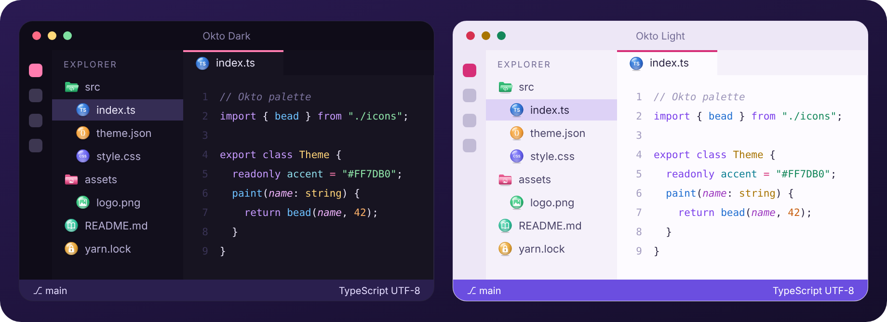
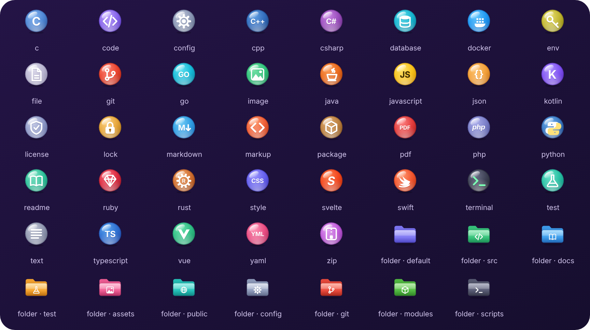

<div align="center">


# Okto

**Светлая и тёмная темы, иконки файлов и значки интерфейса для Visual Studio Code**

Глубокая фиолетово-чернильная тёмная и тёплая лиловая светлая темы с розовым акцентом, богатая подсветка кода и глянцевые цветные иконки-бусины для файлов и папок.

</div>

<picture></picture>

<picture></picture>

## Установка в Windows

1. Склонируйте репозиторий или скачайте его как ZIP.
2. Откройте `%USERPROFILE%\.vscode\extensions` через `Win + R`.
3. Создайте папку `local.okto-theme-2.0.0` и скопируйте в неё `package.json`, `icon.png`, `icon.svg`, а также папки `themes`, `fileicons` и `producticons`.
4. Перезапустите VS Code или запустите **Developer: Reload Window** через `Ctrl + Shift + P`.
5. Выберите цветовую тему клавишами `Ctrl + K`, затем `Ctrl + T`: **Okto Light** или **Okto Dark**.
6. В палитре команд найдите **Preferences: File Icon Theme** и выберите **Okto Icons**.
7. В палитре команд найдите **Preferences: Product Icon Theme** и выберите **Okto Product Icons**.

Тема значков интерфейса меняет встроенные значки VS Code. Значки, которые добавляют отдельные расширения (например, логотипы Python или AI), управляются самими расширениями и могут не заменяться темой.

## Сборка

Темы и иконки генерируются скриптами (нужен `pip install fonttools`):

```
python3 scripts/generate_file_icons.py
python3 scripts/generate_themes.py
python3 scripts/generate_branding.py
```
