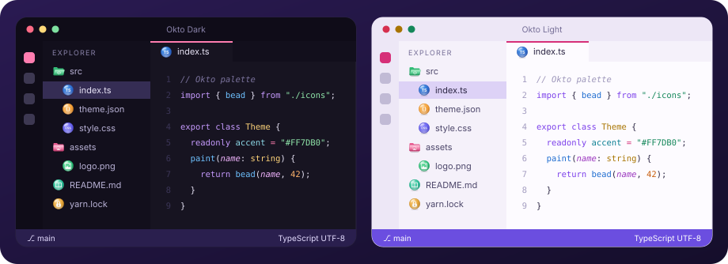

# Okto

**Светлая и тёмная темы и иконки файлов для Visual Studio Code**

Монохромная основа, мягкие панели и розовый акцент. Цветная подсветка кода и спокойные иконки для файлов и папок.

<picture></picture>

## Установка в Windows

1. Склонируйте репозиторий или скачайте его как ZIP.
2. Откройте `%USERPROFILE%\.vscode\extensions` через `Win + R`.
3. Создайте папку `local.okto-theme-1.1.0` и скопируйте в неё `package.json`, `icon.png`, `icon.svg`, а также папки `themes` и `fileicons`.
4. Перезапустите VS Code или запустите **Developer: Reload Window** через `Ctrl + Shift + P`.
5. Выберите цветовую тему клавишами `Ctrl + K`, затем `Ctrl + T`: **Okto Light** или **Okto Dark**.
6. В палитре команд найдите **Preferences: File Icon Theme** и выберите **Okto Icons**.
