<div align="center">

**Русский** · [English](README.en.md)

<br>



<a href="https://github.com/sailxx/Okto-vscode-theme/releases/latest"></a>&nbsp;&nbsp;<a href="CHANGELOG.md"></a>

**Okto для VS Code — две цветовые темы, иконки файлов и цветные папки.** Фиолетово-чернильная **Okto Dark** и тёплая лиловая **Okto Light** с розовым акцентом, плоские цветные иконки для 37 типов файлов и 10 видов папок, подробная подсветка кода. Ни одной строки кода в расширении — только цвет.

</div>

<br>



<details>
<summary><b>Подробнее о возможностях</b></summary>

### Темы

**Okto Dark** — глубокий фиолетово-чернильный фон, светлый текст, розовый акцент `#FF7DB0` (курсор, активная вкладка, номер текущей строки, значки-счётчики). **Okto Light** — тёплый лиловый фон с акцентом `#D62F78` и фиолетовой строкой состояния. Обе темы описывают весь интерфейс VS Code: панели, вкладки, списки, терминал, diff, Git, отладчик, скобки-радуга, значки символов.

### Подсветка кода

Включена семантическая подсветка (`semanticHighlighting`) плюс 30+ правил TextMate: ключевые слова, строки, числа, функции, типы, параметры (курсивом), `this`/`self`, свойства, декораторы, теги и атрибуты HTML, селекторы и свойства CSS, ключи JSON, заголовки и ссылки Markdown, diff.

### Иконки файлов

37 плоских плиток с белым глифом: Python, JavaScript, TypeScript, JSON, YAML, Markdown, HTML, CSS, SQL, Docker, Git, Rust, Go, Java, C, C++, C#, Ruby, PHP, Swift, Kotlin, Svelte, Vue и другие. Отдельные иконки есть для lock-файлов, `.env`, тестов (`*.test.ts`, `*.spec.js`), лицензий, архивов, PDF и текстовых файлов.

### Цветные папки

`src`, `docs`, `test`, `assets`, `public`, `config` / `.vscode`, `.git` / `.github`, `node_modules`, `scripts` — у каждой свой цвет и значок на лицевой стороне, в закрытом и открытом виде. Остальные папки — фиолетовые.

</details>

<br>



<br>


<details open>
<summary><b>Установка</b></summary>

**В один шаг** (склонируйте репозиторий или скачайте его как ZIP):

```powershell
.\install.ps1      # Windows (PowerShell)
```

```bash
./install.sh       # macOS и Linux
```

Скрипт копирует расширение в папку расширений VS Code (старые версии Okto удаляются). Перезапустите VS Code и добавьте в `settings.json` (`Ctrl + Shift + P` → **Preferences: Open User Settings (JSON)**):

```json
"workbench.colorTheme": "Okto Dark",
"workbench.iconTheme": "okto-icons",
"workbench.productIconTheme": "okto-product-icons"
```

Для светлой темы укажите `"Okto Light"`. Те же три пункта можно выбрать в палитре команд: **Preferences: Color Theme**, **File Icon Theme** и **Product Icon Theme**.

**Из `.vsix`:** скачайте `okto-theme-*.vsix` со [страницы релиза](https://github.com/sailxx/Okto-vscode-theme/releases/latest) и выполните `code --install-extension okto-theme-2.0.0.vsix` (или **Extensions → ⋯ → Install from VSIX…**), затем выберите темы, как описано выше.

Тема значков интерфейса меняет встроенные значки VS Code. Значки, которые добавляют отдельные расширения, управляются самими расширениями и могут не заменяться темой.

</details>
